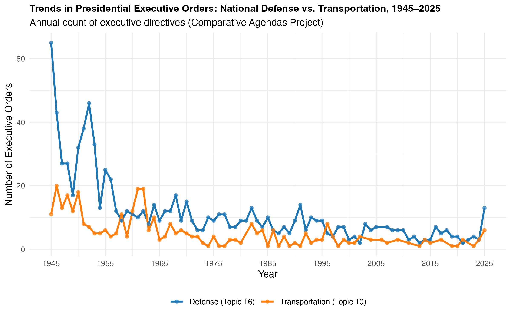
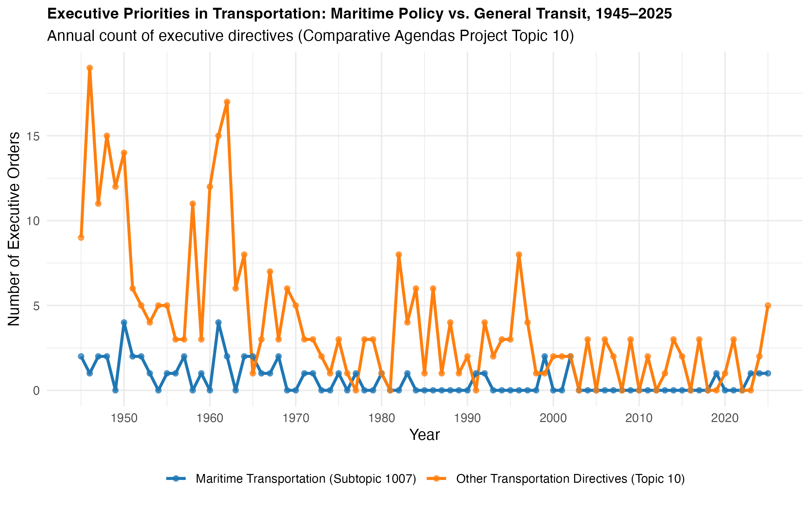
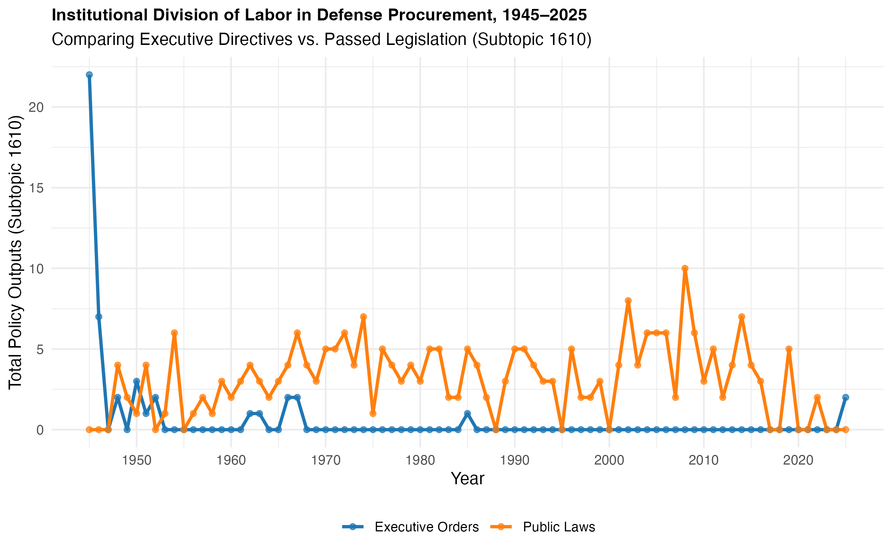

What follows are three visualizations showing...
 
- Figure 1: Trends in Presidential Executive Orders: National Defense (Topic 16) vs. Transportation (Topic 10), 1945–2025

- Figure 2: Executive Priorities in Defense: Military Readiness & Strategic Mobilization (Subtopic 1604) vs. Weapons & Naval Procurement (Subtopic 1610), 1945–2025

- Figure 3: Institutional Division of Labor in Defense Procurement: Presidential Orders vs. Enacted Legislation (Subtopic 1610), 1940s–2020s

- Figure 4: Institutional Division of Labor in Military Readiness, 1945–2025

## Figure 1
{fig-align="center" width="70%"}
Topic 16 covers all 18 defense subtopics combined (intelligence, nuclear arms, personnel, procurement, alliances, etc.), while Topic 10 captures transportation (highways, aviation, maritime, mass transit).

Key Takeaways: Shows overall macro-level executive attention. Defense EOs spiked during post-WWII demobilization and the Korean War, but both domains dropped to a low, stable baseline by the 1980s. It proves that broad, top-level Executive Orders miss narrow policy dynamics.

## Figure 2
{fig-align="center" width="70%"}
1604 (Readiness): Covers military readiness, coordination of air support/sealift capabilities, and national stockpiles of strategic materials.

1610 (Procurement): Covers military procurement, conversion of old equipment, and weapons systems evaluation (including naval shipbuilding contracts).

Key Takeaways: 
- 1945–1950 Spike in Procurement (1610): Post-WWII industrial re-conversion required massive executive management (canceling war contracts, decommissioning naval vessels, reorganizing shipyards).
- Post-1955 Flatline: Executive Orders specifically targeted at procurement and readiness have plummeted to near-zero counts per year.
- Modern presidents rarely use unilateral Executive Orders to address defense procurement or industrial readiness. To rebuild naval power, executive directives alone are historically insufficient.

## Figure 3
{fig-align="center" width="70%"}
Subtopic 1610 explicitly captures policy outputs governing weapons acquisition, fleet modernization, and military industrial base contracts.

Key Takeaways:
- Shows institutional control over weapons, fleet acquisition, and industrial base contracts. Congress consistently dominates policy output via Public Laws (annual NDAAs and spending bills), while unilateral Executive Orders remain at zero for decades. Rebuilding the Navy requires Congressional statutory funding.

## Figure 4
{fig-align="center" width="70%"}
Subtopic 1604 covers operational readiness, sealift capabilities, strategic material stockpiles, and force mobilization.

Key Takeaways:
- Shows institutional control over force readiness, sealift, and material stockpiles. Congress drives major policy overhauls through large legislative spikes, whereas presidential EOs only appear as minor operational triggers during specific national crises.